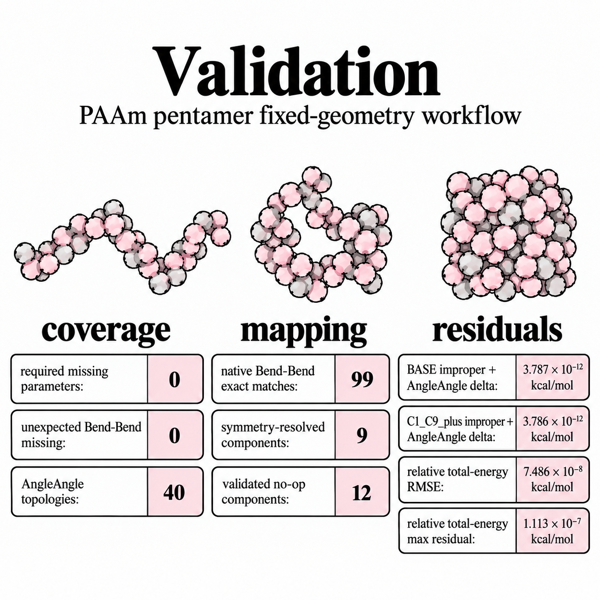
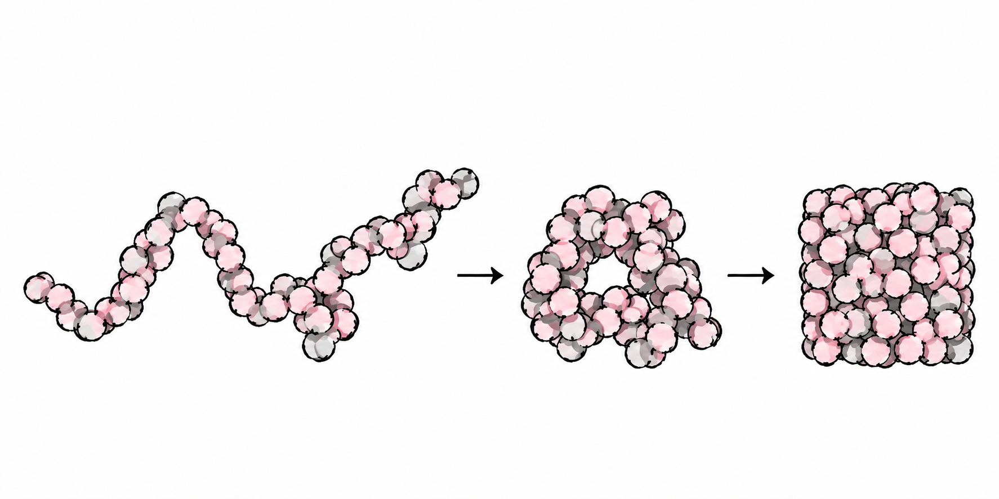

<p align="center">
  
</p>

<h1 align="center">ms-pcff2lammps</h1>

<p align="center">
A strict and auditable PCFF → LAMMPS Class-II conversion toolkit.
</p>

<p align="center">
  <code>Materials Studio</code> → <code>PCFF</code> → <code>LAMMPS</code>
</p>

---

## Overview

`ms-pcff2lammps` converts Materials Studio structures and user-supplied PCFF parameter data into LAMMPS-compatible Class-II bonded topology.

The design goal is simple:

**resolve → audit → translate → verify**

No hidden parameter guessing. No silent replacement. No bundled commercial force-field data.

---

## Pipeline

<p align="center">
  
</p>

```

  CAR / MDF
      │
      ▼
  Topology extraction
      │
      ├──────────────┐
      ▼              ▼
 PCFF OFF       Parameter audit
      │              │
      └───────┬──────┘
              ▼
       Class-II conversion
              │
              ▼
        LAMMPS data
              │
              ▼
       parity validation

```

---

## Features

- PCFF/Class-II bonded parameter resolution
- Explicit parameter provenance tracking
- Fail-closed conversion workflow
- LAMMPS Class-II ordering conversion
- Fixed-coordinate energy parity validation

---

## Quick start

### Install

```bash
git clone https://github.com/Zarathustraaaa/ms-pcff2lammps.git
cd ms-pcff2lammps
python -m pip install .
```

### Audit

```bash
ms-pcff2lammps audit \
  --car system.car \
  --mdf system.mdf \
  --off /path/to/pcff.off
```

### Convert

```bash
ms-pcff2lammps generate \
  --car system.car \
  --mdf system.mdf \
  --off /path/to/pcff.off
```

---

## Validation

Current validated profile:

```
PAAm pentamer
fixed geometry workflow
```

Validation includes:

- parameter resolution checks
- Class-II topology checks
- bonded energy comparison

See:

- `docs/VALIDATION.md`
- `docs/LIMITATIONS.md`

---

## Scope

This project intentionally does not provide:

- Materials Studio files
- PCFF databases
- production nonbonded force-field setup
- universal validation for every chemistry

Users must provide their own licensed force-field resources.

---

## Development

```bash
python -m pip install -e '.[dev]'
pytest -q
```

---

## Beta release requirements

Freeze the candidate commit, including version and release metadata.
The exact commit must first pass Public CI, then pass private PAAm
fixed-coordinate validation using the installed candidate package.

Private validation must confirm `REQUIRED_MISSING = 0`, no unexpected
Bend-Bend misses, the expected fixture topology/mapping counts, and
parity of definitionally equivalent energy groups. Use the matching local
CAR/MDF and PCFF OFF inputs, the native Bend-Bend export required by the
profile, and the private fixed-geometry reference. Record the candidate
SHA, package version, public CI run, Materials Studio/PCFF and LAMMPS
versions, and redistributable aggregate results. Investigate material
deviations without weakening acceptance criteria.

Keep private structures, force-field databases, complete native parameter
exports, reference energies, personal paths, and generated files reproducing
restricted parameter tables outside the repository and release assets.
The historical aggregate record in `validation/paam-pentamer-20260917.json`
does not establish private validation of subsequent commits.

Before tagging, verify repository hygiene and version consistency in
`pyproject.toml`, `CITATION.cff`, and `src/ms_pcff2lammps/_version.py`.
Changes to the candidate SHA require repeating both gates. Record changes
since the last release under `Unreleased` in `CHANGELOG.md`; when preparing
a release, move those changes to the new version and date before freezing
the candidate.

Create a new annotated beta tag only after both gates pass. Do not move
or overwrite an existing release tag. Create the GitHub pre-release
manually only after the tag's Release gate succeeds. Include the exact
tag/commit, validated scope, known limitations, and aggregate validation
results in the release notes.

Public CI and Release gate do not publish to GitHub Releases or package
indexes. Release gate only builds, checks, and uploads CI artifacts;
it does not enforce prior Public CI approval or perform private validation.
Uploaded artifacts do not establish private validation approval.
PyPI publication is outside these workflows.

---

## License

BSD 3-Clause License.

This software is independent research software and is not affiliated with Dassault Systèmes BIOVIA or the LAMMPS project.

<div align="center">

[Documentation](docs/USAGE.md) · [Validation](docs/VALIDATION.md) · [Issues](https://github.com/Zarathustraaaa/ms-pcff2lammps/issues)

</div>
